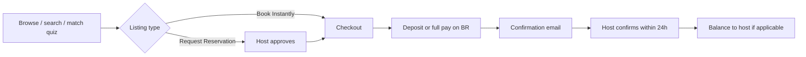
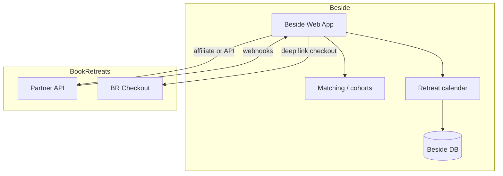

# BookRetreats integration exploration (Beside / Body Double)

**Purpose:** Evaluate how [BookRetreats.com](https://bookretreats.com/) could complement **Beside / Body Double** — NYC in-person study matching today, plus multi-day **study retreats** timed to exam seasons (see `docs/exam-seasons-retreat-windows.md` in the Body Double project store / docs).

**As of:** October 2026. Listings, prices, and availability change frequently; treat counts below as snapshots from public materials, not live inventory.

---

## Executive summary

| Finding | Implication for Beside |
|--------|-------------------------|
| BookRetreats is a **full-service wellness retreat marketplace** (search → inquiry or instant book → deposit/full pay on-platform → host confirms). | Beside is **not** a natural 1:1 category fit today; closest BR segments are **work / digital nomad / writing / silent / mental-health (burnout)**, not bar-prep or exam cohorts. |
| **No self-serve public developer API** found; **partner API** is described as **authorized-only** (JSON/XML, booking linkage) on [RapidAPI listing](https://rapidapi.com/bookretreats/api/bookretreats-wellness-retreats). | Integration path is **partnership conversation** or **affiliate deep links**, not undocumented scraping. |
| **Affiliate program** is open to any registered user (link builder, 3-month cookie, rev-share on BR commission). | Low-friction **MVP discovery** layer for international “study sabbatical” retreats while NYC product matures. |
| **Terms prohibit** spider/crawl/scrape; **robots.txt** disallows `/search?`, `/api/retreat`, checkout, and widget paths. | Scrape-adjacent or third-party wrapper APIs are **legal/ToS risk**; do not build production on them. |
| Host model: **free listing**, **15–30% commission** (visibility tier), deposit on-platform, balance often **direct to host**. | If Beside **hosts** retreats on BR, expect **channel conflict** with Beside-owned checkout unless BR is strictly acquisition. |

**Recommended next step:** Email **support@bookretreats.com** (also listed for affiliates) with a one-pager: Beside = exam-season focus retreats + NYC body-double matching; ask about **partner API access**, **co-marketing**, and **listing policy** for non-yoga “study intensive” retreats.

---

## 1. What BookRetreats sells

BookRetreats positions itself as the world’s largest **curated retreat booking platform** — yoga, wellness, meditation, teacher trainings, and 80+ “other” types across **183+ countries** ([homepage](https://bookretreats.com/), [llms.txt](https://bookretreats.com/llms.txt)).

**Value props for guests**

- Handpicked/vetted listings, **best price guarantee**, **no guest booking fees**, **free cancellation** on many programs ([homepage](https://bookretreats.com/)).
- **24/7 concierge** and a free **Retreat Match** quiz ([/match](https://bookretreats.com/match)).
- Payments in **USD**; **19 currencies** accepted at checkout ([llms.txt](https://bookretreats.com/llms.txt)).
- Social impact messaging (meal donations, carbon-neutral ops).

**Scale signals (Oct 2026, from llms.txt)**

- ~6,556 active listings, ~3,042 hosts, 217k+ verified reviews, 50k+ customers.

**Adjacent product:** [Retreat Jobs](https://bookretreats.com/jobs/why) — job board for retreat staff (membership model), separate from guest booking.

---

## 2. Host / supplier model

| Aspect | Detail | Source |
|--------|--------|--------|
| Who hosts | Retreat centers, independent facilitators; account managers review **new listings in 3–5 days** | [Listing review FAQ](https://bookretreats.com/help/i-just-edited-my-retreat-when-will-the-edits-go-live) |
| Listing cost | **$0** listing fee | [Work with us](https://bookretreats.com/work-with-us), [Fees FAQ](https://help.bookretreats.com/en/articles/2501284-how-do-fees-work-on-bookretreats-com) |
| Commission | **15% base**; hosts may choose **20 / 25 / 30%** for higher search ranking | [Ranking FAQ](https://help.bookretreats.com/en/articles/13571285-how-we-rank-retreats), [Work with us](https://bookretreats.com/work-with-us) |
| Payment flow | Guest pays **deposit (15–100%)** via BookRetreats; **remaining balance** often collected **by host**; 3% processing fee on platform payments | [Fees FAQ](https://help.bookretreats.com/en/articles/2501284-how-do-fees-work-on-bookretreats-com), [Booking summary](https://bookretreats.com/help/explained-in-detail-booking-summary) |
| Host tools | Admin dashboard: retreats, bookings, inquiries, custom offers, capacity, flash sales | [Work with us](https://bookretreats.com/work-with-us), [Bookings FAQ](https://bookretreats.com/help/how-do-i-manage-my-bookings) |
| Payouts | Wise, PayPal, wire | [Work with us](https://bookretreats.com/work-with-us) |
| Policy | Bookings expected **through platform** (min 15% deposit); off-platform steering discouraged | [Book Instantly FAQ](https://bookretreats.com/help/can-i-remove-the-book-instantly-option) |

**Beside angle:** Beside could be **guest** (referral/affiliate), **host** (list “July Bar Sprint — Portugal” style intensives), or **partner** (API + co-brand). Hosting on BR implies accepting their commission, ranking mechanics, and review workflow.

---

## 3. Search and booking flow



**Discovery**

- Nested SEO URLs: `/s/{category}/{subcategory-or-location}` (e.g. [digital nomad retreats](https://bookretreats.com/s/other-retreats/digital-nomad-retreats), [work retreats](https://bookretreats.com/s/other-retreats/work-retreats)).
- Hubs: categories, locations, dates, styles ([llms.txt](https://bookretreats.com/llms.txt)).
- Individual retreat: `/r/{slug}`.

**Booking**

1. **Book Instantly** → checkout, or **Request Reservation** → host accepts → checkout ([How to book](https://bookretreats.com/help/how-do-i-book-my-retreat)).
2. Pay **deposit or full** via card, PayPal, Google Pay, Apple Pay (**USD**) ([How to book](https://bookretreats.com/help/how-do-i-book-my-retreat)).
3. Email confirmation with paid vs still-due amounts ([Booking summary](https://bookretreats.com/help/explained-in-detail-booking-summary)).
4. Host final confirmation (~24h) ([How to book](https://bookretreats.com/help/how-do-i-book-my-retreat)).

**Host booking modes:** Book Instantly, Confirm Availability, Custom Offer ([Book Instantly FAQ](https://bookretreats.com/help/can-i-remove-the-book-instantly-option)).

---

## 4. Categories relevant to study / work / focus

BookRetreats is **wellness-first**. There is **no “bar exam” or “USMLE” category**; Beside would map to adjacent intents:

| BookRetreats segment | Relevance to Beside | Example positioning |
|---------------------|---------------------|---------------------|
| [Work retreats](https://bookretreats.com/s/other-retreats/work-retreats) | **High** — “focused flow,” protected hours | Marketing overlap with “deep work” |
| [Digital nomad retreats](https://bookretreats.com/s/other-retreats/digital-nomad-retreats) | **High** — coworking, Wi‑Fi, accountability | Multi-week exam push abroad (Beside roadmap: Colombia, Portugal, etc.) |
| [Writing retreats](https://bookretreats.com/s/other-retreats/writing-retreats) | **Medium** — thesis/manuscript parallel | Law review note, dissertation cohorts |
| [Silent / mindfulness / meditation](https://bookretreats.com/s/yoga-retreats/silent-retreats) | **Medium** — distraction reduction | Not exam-specific but similar user need |
| [Mental health / anxiety / digital detox](https://bookretreats.com/s/wellness-retreats/mental-health-retreats) | **Low–medium** — burnout, not licensure prep | Careful brand separation (not medical) |
| [Weekend retreats](https://bookretreats.com/s/yoga-retreats/weekend-retreats) | **Medium** for NYC-adjacent short intensives | Aligns with exam-season **weekend windows** |

**NYC / US:** Location pages exist under category trees (e.g. [yoga — United States](https://bookretreats.com/s/yoga-retreats/united-states) per [llms.txt](https://bookretreats.com/llms.txt)). Beside’s **core wedge remains NYC in-person matching**; BookRetreats is stronger for **destination** retreats than hyperlocal study rooms.

**Pricing (illustrative only):** Work/digital-nomad listings often show **from ~US$550** (short Morocco surf+yoga work marketing page) to **multi-thousand** for luxury 1:1 US programs ([work retreats category page](https://bookretreats.com/s/other-retreats/work-retreats)). Always link out for current price — do not cache in Beside UI without a live feed.

---

## 5. Geographic coverage

- **183+ countries**, popular hubs: Bali, India, Costa Rica, Thailand, Mexico, Portugal, Spain, US states including **New York** ([llms.txt](https://bookretreats.com/llms.txt)).
- **Affiliate payouts** worldwide via Wise (175 countries, 50 currencies) ([Affiliate FAQ](https://help.bookretreats.com/en/articles/6636500-how-to-be-in-our-affiliate-program)).
- **HQ / contact:** Berkeley, CA; phone +1 (415) 707-0547 ([affiliate page footer](https://bookretreats.com/affiliate)).

---

## 6. Mobile vs web

| Signal | Observation |
|--------|-------------|
| Web | Primary surface; **Next.js**-style stack (`Allow: /_next/image` in [robots.txt](https://bookretreats.com/robots.txt)). |
| Mobile web | Responsive booking; Apple Pay / Google Pay at checkout ([How to book](https://bookretreats.com/help/how-do-i-book-my-retreat)). |
| Native app | No prominent iOS/Android app marketed on homepage; LinkedIn profiles mention **mobile app** work historically — treat as **web-first** unless partner docs say otherwise. |
| Host notifications | Help articles reference phone notifications for hosts ([Work with us](https://bookretreats.com/work-with-us)) — host-facing, not guest app requirement. |

**Beside implication:** Deep links and responsive web flows are sufficient for MVP; no app SDK integration expected.

---

## 7. Tech and partnership signals

### Public / semi-public

| Asset | Notes |
|-------|--------|
| [Sitemap index](https://bookretreats.com/sitemap/sitemap-index.xml) | SEO discovery; not an API |
| [robots.txt](https://bookretreats.com/robots.txt) | Disallows `/search?`, `/api/retreat`, `/widgets/`, checkout paths |
| [llms.txt](https://bookretreats.com/llms.txt) | AI linking guidance; asks not to cache prices; canonical URL patterns |
| [Terms of Service](https://bookretreats.com/terms) | Prohibits **spider, crawl, scrape**; restricts misuse of inquiry/messaging |
| [Affiliate program](https://help.bookretreats.com/en/articles/6636500-how-to-be-in-our-affiliate-program) | Dashboard link builder; **40–60% of BR’s commission** to affiliate; **3-month** cookie |
| [Trust Seal embed](https://bookretreats.com/help/how-can-i-add-a-trust-seal-to-my-website) | HTML snippet for **hosts** — not a listing widget |
| `/widgets/` disallowed | Suggests internal widget endpoints exist; **not documented** for third parties |

### Partner API (authorized only)

[RapidAPI — BookRetreats Wellness Retreats](https://rapidapi.com/bookretreats/api/bookretreats-wellness-retreats) describes:

- JSON/XML feed for **authorized partners**
- Listings, **real-time availability**, **automated booking** integration
- Copy references “500+ retreats / 100+ locations” (likely stale vs current ~6.5k listings)

**No public OpenAPI**, auth scheme, or webhook docs were found on the open web. Treat as **sales-led integration**.

### Third-party “APIs” (not official)

Services such as [Parse BookRetreats API](https://parse.bot/marketplace/12ad501e-66fd-40cf-b7d7-ddf8e39a4d9c/bookretreats-com-api) explicitly wrap public HTML/JSON-LD — **not** BookRetreats-authorized. Using these in Beside would conflict with [Terms](https://bookretreats.com/terms) and [llms.txt](https://bookretreats.com/llms.txt) freshness rules.

### Jobs / engineering

- [Careers](https://bookretreats.com/careers): remote team; open roles include **Technical Project Manager**, **QA Specialist** — no public “API engineer” posting.
- Marketplace QA job description references **large-scale marketplace** testing ([Djinni listing](https://djinni.co/jobs/724430-quality-assurance-specialist-marketplace-plat/)).
- No job posts found that document public API endpoints.

---

## 8. Integration options (comparison)

| Option | Effort | Fidelity | ToS / legal | Payments | Best for |
|--------|--------|----------|-------------|----------|----------|
| **A. Affiliate deep links** | Low | Discovery only | OK if affiliate T&Cs followed | All on BookRetreats | MVP “also consider these retreats” |
| **B. Official partner API** | High (BD) | Listings + availability + book | OK with contract | Split: deposit on BR | Full marketplace embed |
| **C. Beside hosts on BR** | Medium (ops) | Beside runs BR listing as host | OK | BR commission on BR bookings | Demand gen for Beside-designed retreats |
| **D. Manual CSV / ops sync** | Low | Static | OK for Beside-owned data | Beside checkout | NYC cohorts not on BR |
| **E. Zapier / iPaaS** | Low | Email/form triggers only | OK | N/A | Internal alerts when affiliate dashboard shows conversion |
| **F. Scraping / unofficial API** | Medium | Degrades | **High risk** | N/A | **Do not use** |

---

## 9. User stories (Beside × BookRetreats)

| ID | Story | Integration touch |
|----|--------|-------------------|
| U1 | As a **NYC student**, after matching for weekly body doubles, I want **optional 7–14 day retreat** recommendations before July bar. | Affiliate links to work/digital-nomad retreats + exam-window copy from `docs/exam-seasons-retreat-windows.md` |
| U2 | As a **Beside retreat guest**, I want one **cohort calendar** (NYC + abroad). | Beside canonical calendar; BR listings as **external** or synced via API |
| U3 | As **Beside ops**, I want to **list** “MCAT May Push — Mexico” on BookRetreats for discovery. | Host onboarding on [work-with-us](https://bookretreats.com/work-with-us); deep link back to Beside for matching pre-trip |
| U4 | As a **user who booked on BR** via Beside affiliate link, I want Beside to **know** so we continue NYC matching after return. | Affiliate dashboard manual reconcile, or partner postback if offered |
| U5 | As **finance**, we need clarity on **who charges** what. | BR: deposit + commission; Beside: NYC sessions — avoid double merchant of record without agreement |

---

## 10. Hypothetical partner API shape (if authorized)

*Illustrative only — not sourced from public docs.*

### Endpoints (guess)

- `GET /retreats` — filter by category, location, dates, price, duration
- `GET /retreats/{id}` — detail, media, policies, host
- `GET /retreats/{id}/availability` — sessions, spots remaining
- `POST /bookings` or `POST /inquiries` — create booking/inquiry with affiliate/partner id
- `GET /bookings/{id}` — status

### Auth

- API key + OAuth2 client credentials or signed partner JWT (typical for marketplaces)
- Per-environment keys; IP allowlist possible

### Webhooks (desired)

- `booking.created`, `booking.confirmed`, `booking.cancelled`
- `listing.updated` for cache invalidation

### Rate limits (plan for)

- Search: 60–120 req/min
- Detail: higher cache TTL (15–60 min) aligned with [llms.txt freshness guidance](https://bookretreats.com/llms.txt)

### Beside architecture (target state)



**MVP architecture:** Beside `retreats` page + exam-window campaigns → **affiliate URLs** only; no inventory cache.

---

## 11. Data model sketch (Beside)

Unified model whether source is Beside-native or BookRetreats:

```typescript
// Illustrative — not implemented in repo
type RetreatSource = "beside" | "bookretreats" | "partner_manual";

interface RetreatListing {
  id: string;
  source: RetreatSource;
  externalId?: string;       // BR listing id if known
  slug: string;
  title: string;
  summary: string;
  location: { city?: string; region?: string; country: string; lat?: number; lng?: number };
  categories: string[];      // e.g. "digital-nomad", "writing"
  tags: string[];            // e.g. "bar-prep", "mcat", "thesis", "nyc-adjacent"
  durationDays: number;
  sessions: RetreatSession[];
  capacity?: number;
  priceFromUsd?: number;     // display only with asOf + link out if from BR
  priceAsOf?: string;
  bookingUrl: string;        // affiliate or native checkout
  policies: { cancellation?: string; depositPercent?: number };
  media: { url: string; alt?: string }[];
  host: { name: string; verifiedOnBr?: boolean };
}

interface RetreatSession {
  id: string;
  startDate: string;         // ISO date
  endDate: string;
  spotsRemaining?: number;
  status: "open" | "waitlist" | "sold_out";
}
```

**Exam-season tags:** Map windows from `docs/exam-seasons-retreat-windows.md` to marketing tags (`july-bar-sprint`, `mcat-may-push`, etc.) on **Beside-native** cohorts; BookRetreats listings would use **best-effort** tags from title/description unless API provides taxonomy.

---

## 12. Phased roadmap

### Phase 0 — Research (complete)

- This document; partner outreach draft.

### MVP (4–8 eng-days if affiliate-only)

- Join [affiliate program](https://help.bookretreats.com/en/articles/6636500-how-to-be-in-our-affiliate-program).
- Curated links on `/retreats` by exam season + destination (no price cache; “View on BookRetreats” CTA).
- UTM + affiliate link tracking; monthly reconcile with affiliate dashboard.
- Legal review of affiliate terms + Beside disclaimers (wellness vs exam prep).

### v1 — Beside as host (ops-heavy)

- List 1–2 pilot **study intensive** retreats on BookRetreats; Beside runs cohort matching pre/post.
- Single source of truth for dates in Beside; manual sync of capacity.

### v2 — Partner API (if granted)

- Sync listings/availability into Beside DB; webhooks for booking state.
- In-app “Book” opens BR checkout or embedded flow if partner supports it.
- Attribute affiliate/partner id on every booking.

### v3 — Unified payments (only with explicit agreement)

- Split payouts between NYC matching subscription/session fees and retreat packages — **high complexity**; likely **not** worth merging MoR with BookRetreats without dedicated finance/legal design.

---

## 13. Risks and open questions

| Risk | Mitigation |
|------|------------|
| **Category mismatch** — BR moderators may reject pure “bar prep cram” listings | Frame as wellness + deep work + community; confirm with account manager pre-submit |
| **ToS / scraping** | Partner API or affiliate links only |
| **Stale prices** in Beside UI | Link out; show “from” only with timestamp or live API |
| **Commission stack** | BR host commission + affiliate share ≠ Beside margin; model unit economics |
| **Brand** — psychedelic/adjacent listings on same platform | Curate categories; don’t generic-search embed |
| **NYC focus dilution** | BR for **travel retreats**; Beside native for **NYC matching** |

**Open questions for BookRetreats**

1. Is the RapidAPI partner program still active, and who owns technical onboarding?
2. Are **study / exam / accountability** retreats allowed under which taxonomy?
3. Postback / webhook / server-side conversion API for affiliates?
4. Co-marketing for education partners (law/med/pre-health)?
5. Policy on **dual listing** (Beside checkout + BR discovery)?

---

## 14. Recommended next step

1. **Email support@bookretreats.com** with: Beside one-liner, link to retreats vision, ask for **partner API** or **education/wellness partnership** contact.
2. **Parallel:** Register affiliate account; generate links for [digital nomad](https://bookretreats.com/s/other-retreats/digital-nomad-retreats) + [writing](https://bookretreats.com/s/other-retreats/writing-retreats) pages aligned to `docs/exam-seasons-retreat-windows.md`.
3. **Product:** Keep NYC matching canonical; treat BookRetreats as **optional distribution** for multi-week travel retreats per `src/app/retreats/page.tsx`.

---

## Sources (primary)

- [BookRetreats homepage](https://bookretreats.com/)
- [llms.txt](https://bookretreats.com/llms.txt)
- [robots.txt](https://bookretreats.com/robots.txt)
- [Terms of Service](https://bookretreats.com/terms)
- [Work with us (hosts)](https://bookretreats.com/work-with-us)
- [Affiliate FAQ](https://help.bookretreats.com/en/articles/6636500-how-to-be-in-our-affiliate-program)
- [How do fees work](https://help.bookretreats.com/en/articles/2501284-how-do-fees-work-on-bookretreats-com)
- [How we rank retreats](https://help.bookretreats.com/en/articles/13571285-how-we-rank-retreats)
- [How do I book my retreat](https://bookretreats.com/help/how-do-i-book-my-retreat)
- [RapidAPI — BookRetreats Wellness Retreats](https://rapidapi.com/bookretreats/api/bookretreats-wellness-retreats)
- [Careers](https://bookretreats.com/careers)
